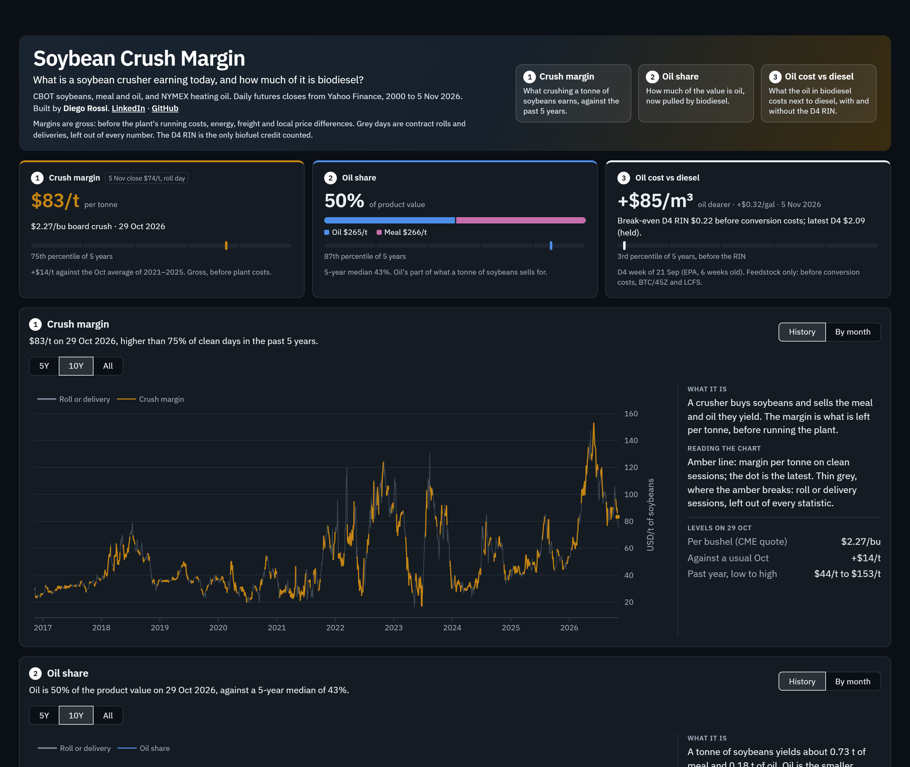

# Soybean Crush Margin

**What is a soybean crusher earning today, and how much of it is biodiesel?**

Built by **Diego Rossi** · [LinkedIn](https://www.linkedin.com/in/rossi-diego/) · [Live app](https://soybean-crush-margin.streamlit.app/)

[](https://soybean-crush-margin.streamlit.app/)
[](https://github.com/rossi-diego/soybean-crush-margin/actions/workflows/ci.yml)
[](https://www.python.org/downloads/)
[](https://github.com/astral-sh/ruff)
[](LICENSE)

A crusher buys soybeans and sells the meal and oil they yield. Since 2021, demand from biodiesel and renewable diesel has pushed soybean oil from about a third of that product value in 2018–2020 (31% to 33% a year) to 39–45% from 2021 to 2025 and 51% in 2026 to date, so the crush margin is now partly a fuel story. This app reads that story from public futures prices, in metric units, and says what it leaves out.



---

## What the page answers

| Question | Card and chart | Unit |
|---|---|---|
| 1. Is crushing paying well or badly now? | Crush margin, its 5-year rank, the board crush per bushel, and this month against the same month of the five previous years | USD per tonne of soybeans |
| 2. How much of the value is oil? | Oil share of the product value, its 5-year median and rank, and the oil and meal value | % and USD per tonne |
| 3. What does the oil in biodiesel cost next to diesel? | The soybean oil for 1 m³ of biodiesel against 1 m³ of heating oil, per m³ and per gallon (the BOHO spread), before and after the D4 RIN. This is the feedstock alone, not the biodiesel price: methanol, energy and plant costs come on top | USD per m³ |

The page repeats one shape three times: three cards of equal size, then one chart per card in the same order, each with its explanation beside it. Every chart has two views:

- **History**: the series over 5 years, 10 years or all of it, with roll and delivery sessions in grey.
- **By month**: the average of clean sessions for each calendar month, this year in bold against the years you pick (up to five) and the range of the five previous years. This year's legend entry reads "2026 (to date)", and the month in progress is a hollow dot, not joined to the line.

The oil cost chart has a switch that adds the D4 RIN to the calculation; the gap after the RIN is drawn in cyan, a colour no other line uses. The third card shows the gap before the RIN and the D4 price that would close it, so it does not depend on the switch. Every number states its date and unit, and the page opens on the latest data with no button to press.

## Quick start

```bash
git clone https://github.com/rossi-diego/soybean-crush-margin.git
cd soybean-crush-margin
python -m venv .venv && source .venv/bin/activate  # Windows: .venv\Scripts\activate
pip install -r requirements.txt
streamlit run app.py
```

The first run downloads about 26 years of daily closes from Yahoo Finance, which takes a few seconds.

### Developer setup

```bash
pip install -r requirements-dev.txt
pytest                                           # tests, and src coverage of at least 95%
ruff format --check src/ tests/ scripts/ app.py  # formatting
ruff check src/ tests/ scripts/ app.py           # lint
mypy src/ app.py scripts/                        # type-check, strict
pip-audit -r requirements.txt --strict           # known vulnerabilities in every runtime package
python -m scripts.readme_figures --snapshot      # the README figures, offline
```

CI runs the tests on Python 3.11 and 3.14, the version Streamlit Community Cloud uses.

The direct dependencies are pinned in `requirements.in` and `requirements-dev.in`. The lock files are generated with [uv](https://docs.astral.sh/uv/) for every platform and Python version, and the dev lock is constrained to the runtime lock, so dev, CI and the live app run the same versions:

```bash
uv pip compile requirements.in --universal --python-version 3.11 -o requirements.txt
uv pip compile requirements-dev.in --universal --python-version 3.11 -c requirements.txt -o requirements-dev.txt
```

To bump a package, edit its pin in the `.in` file, then run the same command with `--upgrade-package <name>`, first for `requirements.txt` and then for `requirements-dev.txt`.

`python -m scripts.readme_figures --write-snapshot` saves the live prices and the D4 cache to `tests/fixtures`, named by the last price date. Point `SNAPSHOT_DATE` in the script at a new pair, then update the README and the expected figures in `tests/test_readme_figures.py` together.

## How it is calculated

| Measure | Formula | Source |
|---|---|---|
| Crush margin | 0.733 × meal + 0.183 × oil − soybeans, all in USD per tonne | CME board crush: 44 lb of meal and 11 lb of oil per 60 lb bushel, which is 0.022 × meal + 0.11 × oil − soybeans in USD per bushel ([CME guide](https://www.cmegroup.com/education/files/soybean-crush-reference-guide.pdf)) |
| Oil share | oil value / (oil value + meal value) | Derived |
| Feedstock cost | 0.90 t of soybean oil per m³ of biodiesel × oil in USD per tonne | EIA plant data, 2017 to 2020, average 7.50 lb per gallon, which is 0.899 t per m³ ([farmdoc daily](https://farmdocdaily.illinois.edu/wp-content/uploads/2022/02/fdd021622.pdf)) |
| Oil cost vs diesel | feedstock cost − heating oil, in USD per m³ | NYMEX heating oil stands in for diesel. The industry quotes the same comparison per gallon as the BOHO spread |
| RIN value | 1.5 D4 RINs per gallon × 264.17 gallons per m³ × weekly D4 price | Equivalence value of biodiesel ([40 CFR 80.1415](https://www.ecfr.gov/current/title-40/chapter-I/subchapter-C/part-80/subpart-M/section-80.1415)); weekly volume-weighted D4 prices from EMTS transactions ([EPA](https://www.epa.gov/fuels-registration-reporting-and-compliance-help/rin-trades-and-price-information)) |
| Gap after the RIN | oil cost vs diesel − RIN value | Each weekly price is used for the sessions of its week and the next. Sessions after the last published week hold that price, are drawn dashed, and are left out of ranks and monthly averages |

Unit conversions use the exact definitions (1 lb = 0.45359237 kg, 1 US gallon = 3.785411784 L) and are tested in `tests/test_constants.py`.

On 2026-10-27, a session pinned in `tests/test_margins.py`, the crush margin was 88.43 USD/t (2.41 USD/bu), oil was 50% of the product value, and soybean oil cost 1,324 USD per m³ of biodiesel against 1,262 USD/m³ for heating oil. The test asserts these figures from that day's closes.

The last EPA week is 2026-09-21, with the D4 RIN at 2.09 USD: about 829 USD per m³ of biodiesel. Yearly averages of the oil cost against heating oil, in USD/m³, on clean sessions, with held RIN prices excluded:

| Year | Gap before the RIN | Gap after the RIN |
|---|---:|---:|
| 2021 | +604 | +85 |
| 2022 | +471 | −160 |
| 2023 | +385 | −232 |
| 2024 | +236 | −72 |
| 2025 | +361 | −2 |
| 2026 (to date) | +368 | −288 |

Most of the 2026 drop after the RIN is the D4 price: it averaged 1.68 USD in 2026 to date against 0.93 USD in 2025, while the gap before the RIN moved from +361 to +368 USD/m³.

On 2026-11-05 the oil cost exceeds heating oil by 85 USD/m³, so a D4 RIN of 0.22 USD would close the feedstock gap, before conversion costs, against 2.09 USD at the last EPA week.

The D4, yearly, roll and risk figures in this README come from `python -m scripts.readme_figures --snapshot` (data to 2026-11-05, committed in tests/fixtures) and are asserted by tests/test_readme_figures.py.

The D4 does not simply close the gap, because the gap is not the producer's whole bill. A negative value after the RIN is what is left to pay for conversion (methanol, energy, the plant) and for margin. Through 2024 the $1/gal blenders' tax credit (BTC, 264 USD/m³) paid part of the gap ([AFDC](https://afdc.energy.gov/laws/395)), and from 2025 the 45Z clean fuel production credit replaced it, with a value that depends on carbon intensity ([IRS](https://www.irs.gov/credits-deductions/clean-fuel-production-credit)). LCFS credits pay in some states ([AFDC](https://afdc.energy.gov/laws/6308)), and renewable diesel, at 1.7 RINs per gallon ([40 CFR 80.1415](https://www.ecfr.gov/current/title-40/chapter-I/subchapter-C/part-80/subpart-M/section-80.1415)), is the marginal gallon.

On 2026-11-05 the RIN value exceeds the feedstock gap by about 743 USD/m³, using a D4 price held since the last EPA week while heating oil kept moving, before conversion costs.

## Risk on a notional crush

This section is analysis behind the page, not on it: `src/risk.py` and `scripts/readme_figures.py` compute it, and the tests hold every figure. It gives the 1-day risk of the crusher's margin on 1,000 t, unhedged (long meal and oil, short soybeans). It is a filtered historical simulation on front-month closes, not a hedge book: each past change is rescaled to today's volatility before it becomes a scenario.

| Measure | Formula |
|---|---|
| Daily change | Δcrush between two consecutive sessions that are both clean, in USD/t. A change that touches a flagged session is dropped, so a roll jump is never a P&L |
| Window | The 5 years to the last clean change, the same as the ranks. Under 250 standardised changes, there is no figure |
| P&L | 1,000 t × Δcrush |
| Daily σ | Standard deviation of Δcrush over the last 20 clean changes and over the last year, in USD/t, not annualised |
| EWMA volatility | σ²ₜ₊₁ = 0.94 σ²ₜ + 0.06 Δ²ₜ over clean changes, seeded with the mean square of the first 30, which never become scenarios |
| Standardised change | zₜ = Δcrushₜ / σₜ, with σₜ from earlier changes only |
| VaR 95% | −1,000 t × σ_next × (5% quantile of z over 5 years), linear interpolation, 1 day, no square-root-of-time scaling |
| ES 97.5% | −1,000 t × σ_next × (mean of z at or below its 2.5% quantile) |
| Backtest | Each change in the 5 years is forecast only from earlier changes; an exception is a P&L below −VaR. Kupiec POF against 5% and Christoffersen independence, each χ² with 1 df |
| ES backtest | The same forecasts at 97.5%: an exception is a P&L below −VaR 97.5%, scored against the ES forecast for its day by Acerbi and Szekely's (2014) Z2, 0 in expectation and negative when the ES is understated |
| Share of ES by leg | Euler allocation of the ES: each leg's mean P&L in the scenarios at or below the 2.5% quantile, over the crush's. The three add up to 100%, and a leg that offsets the others is negative. With 18 tail scenarios the split moves as the window rolls |

On the clean changes to 2026-10-29 (685 in 5 years; data to 2026-11-05), with σ_next = 3.59 USD/t:

| Daily σ, last 20 changes | Daily σ, 1 year | 1-day VaR 95% | 1-day ES 97.5% | Share of ES by leg |
|---:|---:|---:|---:|---|
| 3.91 USD/t | 3.66 USD/t | 6,114 USD | 8,720 USD | oil 69%, meal 28%, soybeans 3% |

A change needs two clean ends, so 685 changes in 5 years is about 137 a year. That is why the window is 5 years: one year would leave about 3 scenarios beyond the 97.5% quantile.

Backtest from 2021-11-17 to 2026-10-29, at 95%:

| Method | Changes | Exceptions | Rate | Kupiec p | Christoffersen p |
|---|---:|---:|---:|---:|---:|
| Filtered HS (shown) | 685 | 33 | 4.8% | 0.83 | 0.29 |
| Plain HS, same window | 685 | 65 | 9.5% | <0.001 | <0.001 |

Plain historical simulation fails both tests: a 5-year equal-weighted window lags volatility regimes, so its exceptions come too often and in clusters (Christoffersen p <0.001). That is why the filtered version is the one to use.

ES backtest at 97.5%, on the same days:

| Changes | Exceptions | Rate | Kupiec p | Christoffersen p | Mean loss / ES | Z2 | p |
|---:|---:|---:|---:|---:|---:|---:|---:|
| 685 | 14 | 2.0% | 0.43 | 0.03 | 0.97 | 0.20 | 0.84 |

Mean loss / ES is the average loss on an exception day over that day's ES forecast. The published −0.70 critical value of Z2 is for 250 days, so the p-value is simulated: 2,000 samples, each drawing every day's outcome from that day's own scenarios, with a fixed seed.

At 97.5%, 2 of the 14 exceptions fall on the clean change right after another exception, so independence is rejected at that level (p 0.03); the 95% exceptions do not cluster (p 0.29).

The three worst clean days of the 5 years, on 1,000 t: −11,743 USD on 2023-07-26, −10,079 USD on 2023-03-23 and −10,035 USD on 2026-06-05.

### What the risk sample leaves out

In the 5 years to 2026-10-29, 436 changes stay in one contract but touch a delivery session, against 685 clean ones. They are more volatile, σ 4.49 against 3.53 USD/t, but leaving them out is not shown to understate the VaR on this sample: on all 1,121 changes the same method gives 5,925 USD against 6,114, and the clean VaR, tested on the 436 left-out changes, has 27 exceptions (6.2%, Kupiec p 0.27). The VaR still does not model taking or making delivery. Scheduled reports in those weeks drop out too: days 8 to 14 of the month, when the WASDE is released, have clean sessions only in February, April and June. The VaR does not include that event risk.

## Rolls and delivery

Yahoo Finance's continuous `=F` series stay in the nearest contract until its last trading day, so they trade through the delivery period and then jump to the next contract. A trader who does not take delivery would have rolled before first notice.

`src/rolls.py` rebuilds approximate CBOT and NYMEX contract calendars and flags every session where a leg is in its delivery period or has just switched contract. Flagged sessions are drawn as a thin grey line and left out of every range and percentile: 42% of crush sessions. Measured on 2000 to 2026, they hold 19 of the 20 largest daily moves in the crush, including the record low of −1.82 USD/bu on 2008-09-12, which was an expiring September contract and not a real margin.

From about 15 October, November beans against December products is the CME board pair. Two stretches are not: late September (Nov beans, Oct products) and the second half of November (Jan beans, Dec products); the rest of each off-pair stretch is already flagged as product delivery. Those sessions are kept, because their daily changes between clean sessions match the board pair's (median 0.86 against 0.89 USD/t), but their level includes a product calendar spread.

## D4 RIN prices

EPA publishes weekly volume-weighted average prices of separated RINs, from EMTS transactions, in a public Qlik Sense app on its [RIN Trades and Price Information](https://www.epa.gov/fuels-registration-reporting-and-compliance-help/rin-trades-and-price-information) page, with no file to download. `src/rins.py` reads the D4 series through the same engine API the page uses, validates it against EPA's own D4 outlier filter (0.05 to 3.00 USD) and the saved series, and caches it. If EPA cannot be reached or the response fails validation, the app uses the dated copy in `data/seed/epa_d4_rin_weekly.csv` and says so on the page.

EPA reloads the data monthly, so the latest RIN price lags the futures by several weeks. The page prints the RIN week and its age next to the RIN value.

## What it leaves out

These are deliberate limits for a project built on free data. A production desk would add each one.

| Left out | Why it matters |
|---|---|
| Plant costs, energy, freight, local basis | The page shows a gross board margin, not plant profit |
| The BTC, 45Z and LCFS credits | The $1/gal blenders' tax credit ran (often renewed retroactively) to 2024; 45Z replaced it in 2025. 45Z and LCFS depend on carbon intensity and state rules |
| Who keeps the RIN | The RIN goes to whoever blends the fuel, so a producer earns it only through the price of biodiesel |
| Daily RIN prices | Daily assessments (Argus, OPIS, Fastmarkets) are paid; the EPA series is weekly and published monthly |
| Energy content | Biodiesel holds about 7% less energy than diesel per unit of volume ([AFDC](https://afdc.energy.gov/fuels/properties)); the gap compares volumes |
| The forward curve | Only the front month is free with history, so there is no forward crush yet |
| Exchange holidays | Calendars use business days, so a flag can be one session off around a holiday |

## Architecture

```
Yahoo Finance: ZS=F, ZM=F, ZL=F, HO=F (daily closes from 2000)      EPA: weekly D4 RIN prices (from 2010)
   |  validated per column, written atomically, falls back to the cache on failure
   v
data/prices.parquet  (local, git-ignored)
   |  load_prices() -> LoadResult, cached for one hour by the app; a failure is never cached
   v
src/margins.py   metric units, crush, oil share, feedstock gap; a missing leg drops the session
src/rolls.py     contract calendars: delivery and switch flags
src/rins.py      D4 RIN loader: cache, EPA, then the saved copy in data/seed
src/seasonal.py  latest clean reading, 5-year percentile, monthly averages by year
src/risk.py      clean daily changes; filtered 1-day VaR and ES, backtests, ES by leg
   |
   v
src/visualization.py (Plotly figures) + src/cards.py (card HTML) + src/text.py (copy)
   + src/wording.py (sentences) + src/styles.py (page CSS) -> app.py (Streamlit page)
```

Logs use `key=value` fields, for example `event=data_load source=cache rows=6714 as_of=2026-11-05`, `event=cache_rejected problems=...` and `event=data_load_failed reason=...`.

## Project structure

```
soybean-crush-margin/
├── app.py                      # Streamlit page only
├── .streamlit/config.toml      # Dark theme
├── docs/screenshot.png         # README screenshot
├── data/seed/                  # Dated copy of the EPA D4 RIN series, the fallback
├── src/
│   ├── config.py               # Paths and cache settings
│   ├── constants.py            # Tickers, units, crush and biodiesel factors with sources
│   ├── data_loader.py          # Yahoo Finance fetch, response validation, Parquet cache
│   ├── rolls.py                # Contract calendars, delivery and switch flags
│   ├── rins.py                 # Weekly D4 RIN prices from EPA, with a saved fallback
│   ├── margins.py              # Crush margin, oil share, feedstock gap
│   ├── seasonal.py             # Percentile rank and monthly averages on clean sessions
│   ├── risk.py                 # Clean daily changes, filtered VaR and ES, backtests, ES by leg
│   ├── visualization.py        # Plotly figure builders, no UI imports
│   ├── cards.py                # HTML for the cards, rails and method notes
│   ├── wording.py              # Sentences and numbers as the page prints them
│   ├── styles.py               # The page CSS
│   └── text.py                 # Page copy, held to length limits by tests
├── scripts/readme_figures.py   # The D4, yearly, roll and risk figures in this README
├── tests/                      # Unit tests per module, and the page end to end with AppTest
│   └── fixtures/               # Dated price and D4 snapshot behind the README figures
├── .github/workflows/ci.yml    # CI: lint, type-check, test, audit
├── pyproject.toml              # Ruff, mypy, pytest configuration
├── requirements.in             # Runtime dependencies, direct pins
├── requirements.txt            # Runtime lock, generated by uv
├── requirements-dev.in         # Development dependencies, direct pins
└── requirements-dev.txt        # Development lock, generated by uv
```

## Key design decisions

| Decision | Why |
|---|---|
| **Flag, do not fix, the rolls** | A back-adjusted series needs every contract's history, which is not free. Flagging delivery and switch sessions keeps every number traceable to a real close and stops expiry artefacts from setting records. |
| **Metric units** | European and Brazilian desks think in tonnes and m³. The CME per-bushel value is shown beside the headline for anyone who quotes the board crush. |
| **A missing leg drops the session** | A forward-filled price would invent a margin. |
| **Amber means the crush margin, nothing else** | Controls and the other cards stay neutral, so the colour keeps one meaning. No green or red: a margin level is not a verdict. |
| **One shape, three times** | Each card, chart and explanation has the same structure and size, so a reader learns the page once. Copy length limits are tested, so the text beside a chart cannot outgrow it. |
| **Monthly averages, not daily overlays** | About 4 in 10 crush sessions are flagged, mostly in the first half of delivery months, so a daily seasonal line would be full of holes. A month-year needs 5 clean sessions. |
| **Validated, atomic cache** | A download replaces the cache only if each column keeps at least 90% of its cached observations and does not end earlier, so a partial Yahoo response cannot overwrite good data. |

## History

This repository started as a rule-based simulator on seven commodity futures. An audit showed that roll handling could flip the sign of its results and that its rules were not how processors and merchants work, so the project was refocused on the margin a crusher actually manages. The earlier code is in the git history.

---

Personal project, not affiliated with any employer. Not investment advice.
